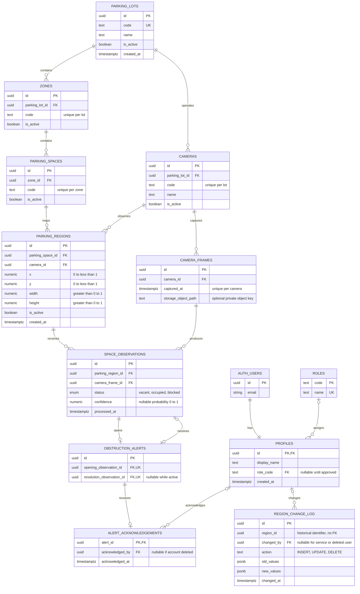

# ParkVision database and normalized ERD

Run [`202610200001_initial_schema.sql`](../supabase/migrations/202610200001_initial_schema.sql)
in **Supabase → SQL Editor → New query**. It creates tables, foreign keys, indexes,
triggers, row-level security (RLS), and API functions in one transaction. This is
a one-time migration for a new project; it fails instead of overwriting conflicting
tables. If you already ran it, keep the database and run only the updated seed
when changing the sample capacity. The app's connection is implemented; follow
[the connected-app guide](run-connected-app.md) to add credentials and sign in.

## Entity relationship diagram

Supabase manages `auth.users`. The other 12 tables belong to ParkVision. Views and
functions are API conveniences, not extra entities.



`region_change_log.region_id` has no FK so audit records survive region deletion.
Only one region per space can be active, although archived mappings can exist.
A frame can classify many regions; each frame/region pair has at most one observation.

## Normalization

The operational tables follow third normal form (3NF):

- Each field holds one value, and each table has a primary key (1NF).
- Attributes describe the whole key; natural uniqueness is enforced for zone/lot,
  space/zone, camera/lot, and frame/region pairs (2NF).
- Lot/zone labels, role names, and camera details live in their own tables. An
  observation references its region and frame instead of repeating space, zone,
  lot, or camera fields. Alerts reference observations instead of repeating
  status, space, or detection timestamps (3NF).
- Current status and totals are derived views, avoiding stored occupancy counters
  that can drift out of sync.

The audit table is intentionally a snapshot store: JSONB preserves old and new
values without changing when the operational row changes.

Assumptions: one approved personnel role per account; all personnel belong to one
organization and their role applies to all lots. Site-specific staff assignments
and simultaneous multi-camera fusion would need additional tables. Customers do
not need accounts. Reservations, payments, plate/facial recognition, and navigation
are outside the requirements.

## Supabase setup

1. Run the migration once. Tables and foreign keys appear in Supabase's database
   schema visualizer.
2. Optionally run [`seed.sql`](../supabase/seed.sql): Luzano Compound, zones A/B/C,
   **15 active spaces** (five per zone), CAM-04, and two sample regions. Set
   `v_total_spaces := 12` through `15` near the top to match the confirmed count.
   Calibrate regions on real frames. No detections are fabricated; unobserved
   spaces show `unknown`.
3. Create your account through **Authentication → Users** or Supabase Auth.
   Sign-in uses email/password. Do not import the prototype's bcrypt hashes or
   custom JWT secret. A trigger creates a profile with **no personnel role**,
   regardless of signup metadata. Existing Auth accounts are also backfilled.
4. Bootstrap the first administrator in SQL Editor, replacing the email:

   ```sql
   update public.profiles
   set role_code = 'parking_administrator', display_name = 'Parking Administrator'
   where id = (select id from auth.users where email = 'you@example.com');

   select id, display_name, role_code from public.profiles;
   ```

5. Assign other accounts `security_personnel` or `parking_personnel` through SQL
   Editor or an authenticated administrator. Users cannot assign themselves roles.
6. Use the project URL and publishable/anon key in the frontend. Keep the
   service-role key in the backend/CV service only.

### Already ran the old 48-space seed?

Keep the Supabase project, tables, and accounts. Do **not** rerun the initial
schema migration. Copy the entire updated [`seed.sql`](../supabase/seed.sql) into
a new SQL Editor query and run it as the database owner. The script works both
after the initial schema alone and after the old 48-space seed.

It preserves existing IDs and history, activates the chosen 12–15 labeled spaces,
and archives all other spaces in the `LUZANO` lot by setting `is_active = false`.
It also archives regions belonging to those extra spaces. Other lots are
untouched, and current calibration for retained spaces is preserved. This is an
authoritative sample layout for Luzano: review the A/B/C labels before running
it on a lot you have manually relabeled.

The SQL Editor result should show `total = 15` by default. Archived spaces remain
in Table Editor for history but are excluded from `parking_status` and totals.
To see only current spaces, filter `parking_spaces` by `is_active = true`.
Rerunning the script does not duplicate spaces or erase detections. Growing the
layout later does not automatically restore archived region calibration; those
regions need review before reactivation.

The connected frontend reads the active capacity from Supabase; no separate demo
count needs changing. The sample zones are labels, not a measurement of the actual
layout.

The migration uses Supabase's [Auth profile pattern](https://supabase.com/docs/guides/auth/managing-user-data)
and [RLS/grants model](https://supabase.com/docs/guides/database/postgres/row-level-security).
Private helpers have fixed empty search paths. The public status function
intentionally runs with owner privileges, returning only a fixed safe projection.
Anonymous callers never receive frame paths, camera details, coordinates, or raw
observation rows. Both public views use `security_invoker = true`.

## Access rules

| Caller | Access |
| --- | --- |
| Public visitor or unapproved account | Read lot/zone/space labels, latest statuses, totals. |
| Security or parking personnel | Public access plus camera/frame metadata, regions, observations, alerts; acknowledge active alerts through RPC. |
| Parking administrator | Monitoring access plus manage layout, cameras, regions, personnel profiles/roles; read region audit history. |
| Backend/CV service | Insert frames and observations; triggers create/resolve alerts. Service keys are privileged and stay on the server. |

No browser role can insert detections, change audit records, or directly edit
alert state/acknowledgements. Every application table has RLS and explicit grants.
Frames/observations are append-only for API roles. Archive referenced configuration
with `is_active = false`; foreign keys block deletion of rows used by history.

`camera_frames.storage_object_path` is an optional reference. This migration does
**not** create a Storage bucket, upload images, or grant Storage access. If storing
footage, create a private bucket with separate personnel-only Storage policies.
Do not store public footage URLs or camera passwords in these tables.

## Frontend connection (implemented)

The frontend uses `@supabase/supabase-js`; the backend exposes the URL and public
key from its `.env` through `/api/config`. Example API shapes:

```js
// Customers do not need to sign in.
const { data: rows, error } = await supabase.from('parking_status').select('*');
if (error) throw error;
// id is the stable UUID; code is the A1/B1 display label.
// confidence is a 0–1 model score; do not treat it as measured accuracy.

const { data: totals } = await supabase.from('parking_summary').select('*');
const { error: loginError } = await supabase.auth.signInWithPassword({ email, password });
const { data: acknowledgement, error: ackError } = await supabase.rpc('acknowledge_alert', {
  p_alert_id: alertId,
});
```

The connected frontend renders unknown/stale results as Unverified, not blocked.
`unknown` means no observation exists; `is_stale` means the last captured frame is
older than 10 seconds (or absent). Unknown/stale results are excluded from available
counts. The public screen calculates effective freshness on each polling update.
Active spaces retain their last result even if their old region is archived.

Poll status/alerts every 2–3 seconds, then measure full detection-to-display latency
against the 5-second target. Realtime is not configured; views do not emit events.

Express `requireAuth.js` verifies each token with Supabase Auth and reads the
caller's approved profile role. Personnel operations use the caller's session so
RLS applies. The server-only service-role client is limited to publishing model
observations after authenticated preview and saved-geometry checks.

## CV ingestion and alerts

1. Using a server-side service-role client, insert a `camera_frames` row with its
   camera UUID and capture timestamp. Reuse `(camera_id, captured_at)` on retries.
2. For each active region in that frame, call:

   ```js
   const { data, error } = await serverSupabase.rpc('record_observation', {
     p_region_id: regionId,
     p_frame_id: frameId,
     p_status: 'blocked', // vacant | occupied | blocked
     p_confidence: 0.94,
   });
   ```

3. The database checks matching cameras, active configuration, confidence range,
   and uniqueness. A repeated frame/region pair is rejected; read its existing
   observation rather than duplicating it.
4. A latest blocked result opens an event; repeated blocked results keep it open.
   Vacant/occupied resolves it. A later obstruction creates a new event without
   the previous acknowledgement.
5. Capture time determines freshness. Older frames are stored as history but
   cannot override current status or reopen alerts. Space-row locks serialize
   concurrent observation inserts for each space.

Coordinates are fractions: `x = pixelX / frameWidth`, `width = pixelWidth /
frameWidth`, and similarly for Y/height. Geometry edits are audited. To change a
region's camera/space mapping, archive it and create another; parent links cannot
be reassigned under existing history.

This database stores classifications. Camera ingestion, object detection, Storage,
and measurement of the accuracy/latency/usability/uptime targets remain app work.

## Validation

[`schema_checks.sql`](../supabase/tests/schema_checks.sql) runs transactional checks
and rolls back fixtures. Run as database owner after migration, preferably in a
development project. It checks role boundaries, validation, public redaction,
audit snapshots, counts, late frames, and new obstruction acknowledgements.
Fixtures do not create usable Auth login sessions.

The migration, checks, existing-user backfill, RLS enablement, and repeatable seed
were validated locally with PostgreSQL via PGlite and a minimal Supabase Auth/role
test scaffold. A hosted Supabase project, Storage policies, and concurrent clients
were not exercised.
