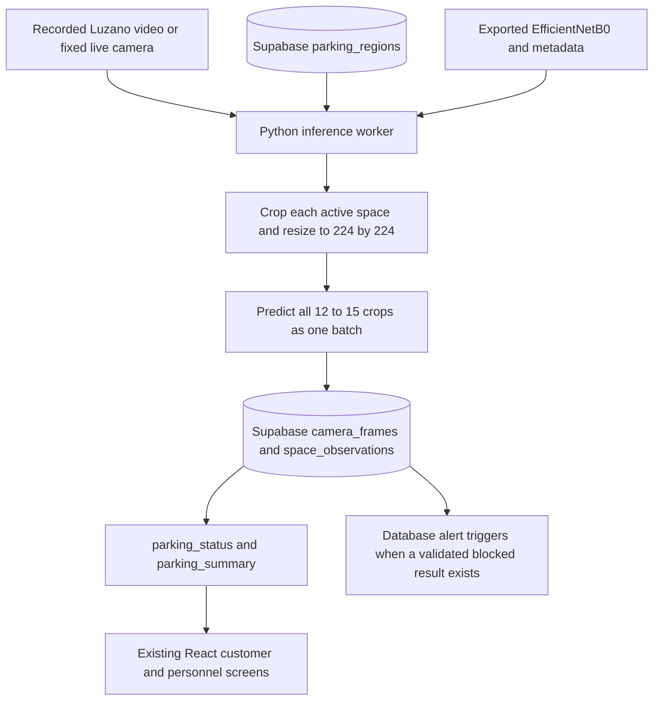

# Integrating the S2 model into ParkVision

The image/video-frame integration described below is now implemented locally.
See [Run the connected app](run-connected-app.md) for current commands,
credentials, administrator setup, and the upload/draw/analyze/publish flow.
The trained export is copied locally into `ml/models` and ignored by Git. The
PDFs themselves contain results and code, not model weights.

## What the experiments actually provide

S1 inspects and cleans PKLot and Vehicles-COCO2 independently. Its 224×224,
0–1 normalization cell is an example on a sample image. Cleaning, splitting,
augmentation, and training do not need to run every time the app makes a prediction.

S2 trains on **cropped individual parking spaces**, not entire parking-area images.
It preserves the PKLot splits and compares binary occupancy classifiers using
16,000 training, 4,000 validation, and 4,000 test crops. It excludes Vehicles-COCO2.

| Property | S2 contract |
| --- | --- |
| Selected model | EfficientNetB0 with the trained binary classification head |
| Reported test accuracy | 0.96875, rounded to 96.88% |
| Reported F1 | Approximately 0.9695 |
| Input | Batch of RGB parking-space crops, float32, 224×224×3 |
| Input values | 0–255; EfficientNet preprocessing is inside the model |
| Class order | 0 = `space-empty`, 1 = `space-occupied` |
| Output | One sigmoid score per crop: occupancy score `p` |
| Experimental threshold | `p >= 0.5` means occupied |

The winning model does **not** identify vehicle types or non-vehicle obstructions.
Its occupied class is not proof that the object is a vehicle. The reported binary
accuracy does not validate three-way vacant/vehicle/obstruction classification or
performance on the Luzano camera.

Sources inspected: `M1S1_Dataset_Cleaning_and_Preprocessing.pdf` (especially pages
7 and 13) and `M1S2_Experimental_Result_Colab_Guide-2.pdf` (especially pages 4–9,
13, 15, and 16), supplied from the user's Downloads folder.

## First step: export the trained model from Colab

In Colab's Files pane, look for a `.keras` or `.h5` export. If there is none, add
this cell **after S2's EfficientNetB0 training/evaluation**, while the trained
`efficientnet_model` object and `test_ds` still exist:

```python
import hashlib
import json
from pathlib import Path
import numpy as np
import tensorflow as tf

output = Path('/content/parkvision_model')
output.mkdir(exist_ok=True)
model_path = output / 'parkvision_efficientnetb0.keras'

# Save the TRAINED object, including its classification head and preprocessing.
efficientnet_model.save(model_path)

# Check that reloading preserves inference on the same real test examples.
sample_batch, _ = next(iter(test_ds))
before = efficientnet_model(sample_batch, training=False).numpy()
reloaded = tf.keras.models.load_model(model_path, compile=False)
after = reloaded(sample_batch, training=False).numpy()
np.testing.assert_allclose(before, after, rtol=1e-5, atol=1e-6)

metadata = {
    'model_name': 'EfficientNetB0_PKLot',
    'model_version': 's2-binary-v1',
    'class_names': ['space-empty', 'space-occupied'],
    'input_size': [224, 224],
    'color_mode': 'RGB',
    'input_dtype': 'float32',
    'input_range': [0, 255],
    'resize_method': 'bilinear',
    'preprocessing_inside_model': True,
    'occupied_threshold': 0.5,
    'tensorflow_version': tf.__version__,
    'keras_version': tf.keras.__version__,
    'sha256': hashlib.sha256(model_path.read_bytes()).hexdigest(),
}
(output / 'metadata.json').write_text(json.dumps(metadata, indent=2))
print('Saved model, metadata, and passed save/reload comparison:', output)
```

Download BOTH files from Colab's Files pane and keep them together. Persist a
copy outside the temporary Colab runtime. If the runtime reset before the weights
were saved, rerun the training notebook or restore a real saved checkpoint; the
PDF's metrics cannot reconstruct the trained weights. Rebuilding ImageNet
EfficientNetB0 alone would discard the trained parking classification head.

Use the exported TensorFlow/Keras versions initially. Upgrade or convert only
after comparing predictions against the original export. Keras documents whole
model export/reload [here](https://keras.io/guides/serialization_and_saving/).

## Runtime architecture



Run Python alongside the existing Express/React application, on a computer or
server that can access the camera. Training remains in Colab; routine inference
loads the exported model once at startup. Supabase stores results and serves
them to the app. This design does not require running TensorFlow inside SQL or
converting the model to JavaScript.

A continuously running worker is enough for automatic camera monitoring. Add a
small authenticated Python HTTP API later if the app needs on-demand image
analysis or job controls; a separate HTTP API is not required just to publish
live results. Keep Express for application endpoints if needed.

## Configure the real parking spaces

The seed has 12–15 spaces but only **two sample regions**, A1 and A2. Define one
real calibrated region for every active space before expecting full coverage.
Each region links a space UUID to the camera UUID that sees it. The camera must
remain fixed; recalibrate if it moves.

Use the region's normalized coordinates against the source frame:

```text
left   = floor(x * frame_width)
top    = floor(y * frame_height)
right  = ceil((x + width) * frame_width)
bottom = ceil((y + height) * frame_height)
```

Clamp to image bounds and reject empty crops. S2 uses rectangular crops, so start
with that same geometry. If perspective or overlapping spaces make rectangles
insufficient, evaluate a revised crop/mask pipeline on real data before deploying.

Convert camera frames to RGB; OpenCV frames need BGR→RGB conversion. Resize each
crop using bilinear interpolation, cast to float32, and preserve its region UUID
and batch position. Do not feed the entire lot into a classifier trained on one
space at a time.

**Do not divide these inputs by 255 again.** S2 passes unscaled directory-loader
pixels into EfficientNetB0, which contains its own scaling. See the official
[EfficientNet input contract](https://keras.io/api/applications/efficientnet/efficientnet_models/).
Augmentation and dropout must be inactive during inference (`training=False`).

## Predict and publish results

For a prepared batch named `crops` with shape `[number_of_regions, 224, 224, 3]`:

```python
model = tf.keras.models.load_model('parkvision_efficientnetb0.keras', compile=False)
# In the worker, load once above the processing loop.
probabilities = model(crops, training=False).numpy().reshape(-1)

results = []
for region, probability in zip(regions, probabilities):
    p = float(probability)
    if not np.isfinite(p) or not 0 <= p <= 1:
        raise ValueError('Invalid model output')
    results.append({
        'region_id': region['id'],
        'status': 'occupied' if p >= 0.5 else 'vacant',
        'confidence': p if p >= 0.5 else 1 - p,
    })
```

Verify output count equals crop count before pairing IDs; `zip` alone must not
silently hide missing predictions. These sigmoid values are model scores, not a
guarantee that an individual prediction is correct. Thresholds should be validated
on held-out Luzano data rather than chosen using the final test set.

Using a server-side Supabase client:

1. Read active regions for the selected camera and active spaces. Refresh region
   configuration when administrators change it.
2. Capture a fresh frame and retain its acquisition timestamp.
3. Crop, preprocess, and batch-predict the configured spaces.
4. Insert one `camera_frames` record for the processed frame and use its returned
   UUID for every observation from that frame. `storage_object_path` can be NULL;
   storing image/video files is not required to store classifications.
5. For each result, call the existing function:

   ```python
   response = supabase.rpc('record_observation', {
       'p_region_id': result['region_id'],
       'p_frame_id': frame_id,
       'p_status': result['status'],
       'p_confidence': result['confidence'],
   }).execute()
   ```

6. Reuse `(camera_id, captured_at)` on retries. A repeated frame/region pair
   already has an observation and must not be duplicated.

Python's RPC interface is documented
[here](https://supabase.com/docs/reference/python/rpc). Use the service-role key
only inside the Python/backend process; the React app uses the public key and
the user's Auth session. Do not also update the prototype's in-memory
`PUT /api/stalls/:id` route: it would create two disconnected sources of status.

Keep using the current schema. No database reset or table deletion is needed for
this binary occupancy integration. Model artifacts live with the Python worker.

## Connect React

Replace `seedStalls()` in `frontend/src/App.jsx` with reads of `parking_status` and
`parking_summary`; see [the database guide](database.md) for the adapter. Render
loading, unknown, stale, and error states. Use `observed_at`/`updated_at` instead
of the hardcoded update message. The initial frontend has no Supabase client yet.

Poll about every two seconds initially, without overlapping requests. Measure the
processing, database-write, and polling delay together against the 5-second target.
Start with one fresh frame per second and batch all spaces; benchmark on the
actual worker hardware before promising that rate. Avoid a growing frame queue:
for live monitoring, process the latest frame rather than falling behind.

For recorded-video demos, timestamp each replay acquisition consistently with
replay speed. For live monitoring, preserve the real capture time. Do not refresh
timestamps on cached frames just to make them appear live. No camera frame should
leave its most recent status looking fresh indefinitely.

## Handle the missing obstruction capability

Phase one integrates the winner exactly as evaluated: **vacant versus occupied**.
Label the UI accordingly; do not call the occupied result confirmed vehicle
detection and do not generate non-vehicle warnings from it. Camera failure and
low confidence also do not mean `blocked`. Skip unusable results and surface
unknown/stale status rather than inventing a new classification.

To fulfill the original three-class requirements, retain EfficientNetB0 as the
occupancy baseline and do one separately validated extension:

- Fine-tune a three-class EfficientNet classifier with labeled empty spaces,
  vehicles, and representative non-vehicle obstructions such as cones and boxes.
  Change the output head/loss/metadata and compare per-class metrics. This is a
  new model version, not the original binary winner unchanged.
- Or combine the occupancy model with an independently trained/validated detector
  that recognizes vehicles and relevant obstructions. Define overlap rules for
  each parking region. Absence of a vehicle detection alone is not evidence of a
  non-vehicle obstruction; the detector can simply miss a vehicle.

Write ONE final classification per frame/region after combining evidence. The
current uniqueness constraint intentionally prevents separate models from writing
conflicting observations for the same pair. Only validated `blocked` results
should activate the existing obstruction alert triggers. Binary predictions must
not overwrite a deployed three-class pipeline or resolve its alerts independently.

## Delivery order and checks

1. Export the trained model and verify save/reload parity in Colab.
2. Run the loaded export on the same saved PKLot crops; confirm labels,
   preprocessing, and numerical agreement with notebook outputs.
3. Calibrate all 12–15 slots on a Luzano frame and label a small local evaluation
   set across daylight, shadows, night, empty/occupied cases, and obstructions.
4. Build/test a single-frame Python pipeline, then recorded-video replay, then
   the live worker. Measure per-space predictions and capture-to-display timing.
5. Publish to the existing database and connect React to real statuses. Stop the
   worker deliberately and verify the stale/unknown experience.
6. Evaluate the obstruction extension separately before claiming the original
   three-class scope is complete. Report binary and three-class metrics separately.

The S2 training times are not deployment latency measurements. PKLot test accuracy
is a starting benchmark, not evidence of 90% accuracy at the Luzano site. The
local image/video integration is implemented. Hosted Supabase verification still
needs credentials and an administrator account; final site calibration, validation,
and HTTPS access for live phone capture remain pending.
